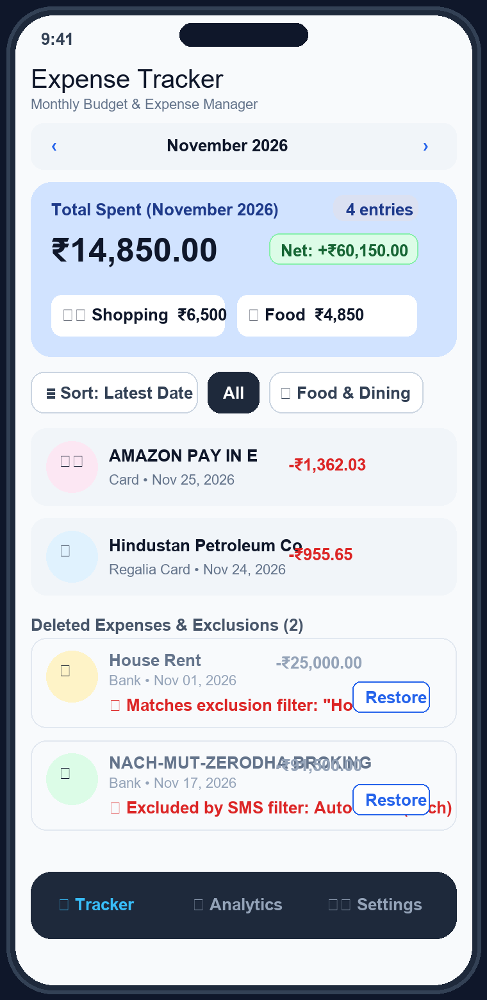
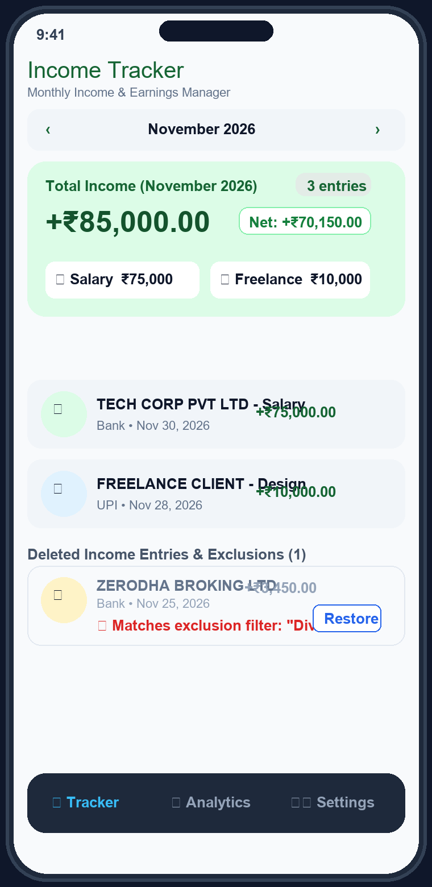
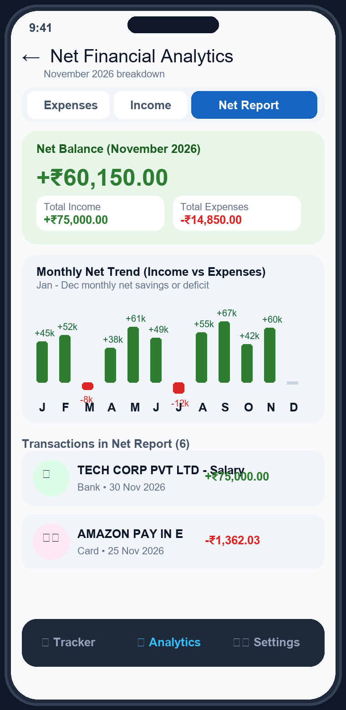
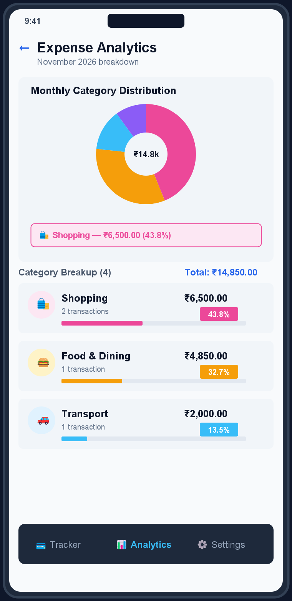
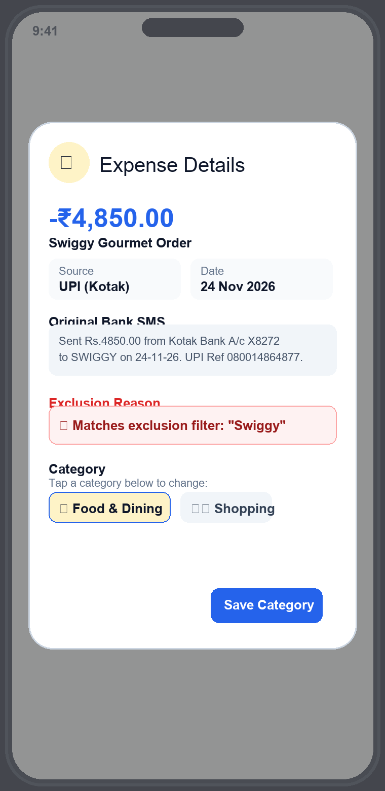
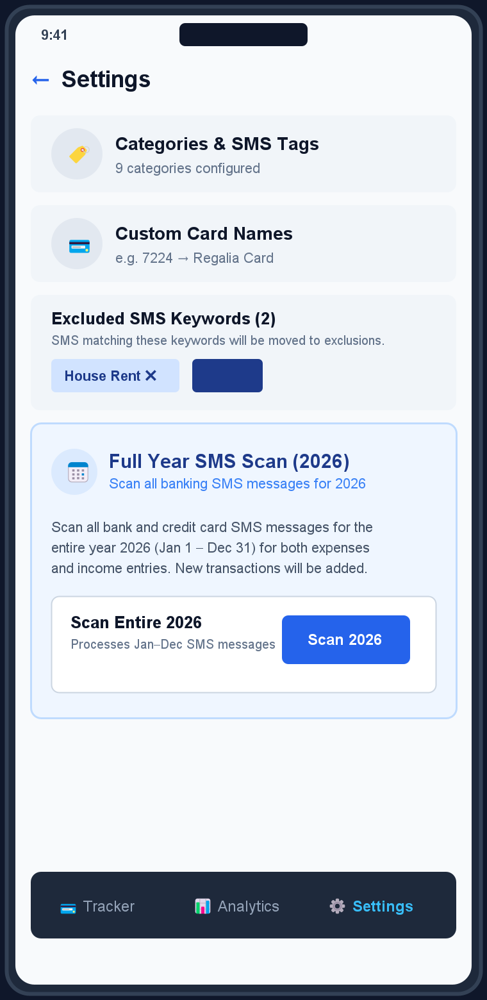
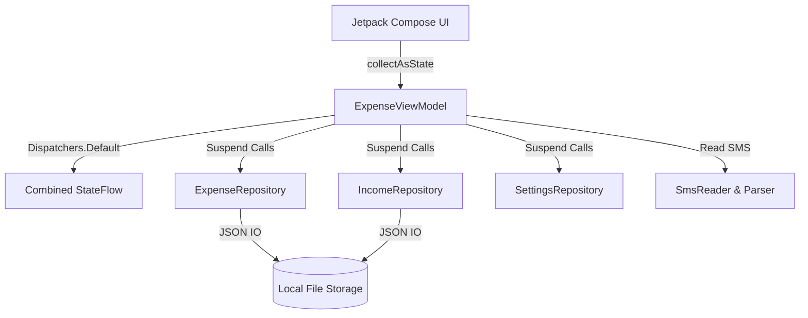

# 💸 Personal Expense & Income Tracker

A modern, privacy-first Android application for automated expense and income tracking, SMS bank parsing, budget management, and financial analytics built with **Jetpack Compose**, **Kotlin Coroutines**, and **Material 3**.

---

## 📥 **Direct APK Download & Installation**

Anyone can download and install the app directly on their Android phone without needing to compile from source!

### **[👉 Click Here to Download APK (`releases/PersonalExpenses-v1.0.apk`)](releases/PersonalExpenses-v1.0.apk)**

#### 📲 **How to Install on Your Android Phone:**
1. **Download:** Click the download link above or open `releases/PersonalExpenses-v1.0.apk` on your phone.
2. **Install:** Tap the downloaded `.apk` file to install. If prompted by Android, tap *"Allow from this source"* for your browser or file manager.
3. **Permissions:** Open the app and grant **SMS permission** when prompted so it can automatically detect and categorize your banking messages.

---

## 📱 App Screenshots & Visual Feature Showcase

| 💳 1. Expense Tracker Mode & Exclusions | 💰 2. Income Tracker Mode | 📊 3. Net Financial Analytics |
| :---: | :---: | :---: |
|  |  |  |

| 🥧 4. Monthly Category Breakdown | 🔍 5. Item Details & Re-Categorization | ⚙️ 6. Settings & Full Year Scan |
| :---: | :---: | :---: |
|  |  |  |

---

## 🌟 Detailed Feature Guide

### 📊 **1. Dual Mode: Expense & Income Tracker**
* **Instant Mode Switching:** Tap anywhere on the main summary card on the home screen to flip seamlessly between **Expense Tracker** and **Income Tracker**.
* **Real-time Net Savings Badge:** Prominently highlights your current net monthly savings (`Income - Expenses`) on the top summary card.

### 📩 **2. Automated SMS Parsing & Auto-Categorization**
* **Bank SMS Auto-Reader:** Automatically scans bank and credit card SMS handles (Kotak, HDFC, ICICI, SBI, Axis, Swiggy, Zerodha, etc.) for debits and credits.
* **Smart Merchant & Tag Detection:** Auto-classifies transactions into categories based on merchant names, UPI handles, and custom keywords.
* **Custom Card Name Mapping:** Map 4-digit card numbers to custom names (e.g. `7224` $\rightarrow$ `Regalia Card`).

### 🚫 **3. Exclusion Filters with Exact Reason Highlights**
* **Smart Filtering:** Ignores non-transaction messages (OTPs, bank statement notices, failed payment alerts).
* **Exact Reason Pointers:** Transactions matching exclusion rules (such as NACH mandates, Mutual Funds/SIPs, CRED/CheQ payments, or custom user exclusion keywords) are stored in the **Deleted / Exclusions** list with explicit reasons:
  * `🚫 Matches exclusion filter: "House Rent"`
  * `🚫 Excluded by SMS filter: Auto-debit / Mandate (nach)`
  * `🚫 Excluded by SMS filter: Investment / Demat (zerodha)`
  * `🚫 Excluded by SMS filter: Credit card bill payment (CRED)`
* **Detail Inspection Popup:** Tapping any category emoji icon opens the **Item Details Dialog** displaying original SMS text, exact exclusion reasons, and category customization chips.

### 📈 **4. Net Financial Analytics & Interactive Reports**
* **Net Report Mode:** Toggle between **Expenses**, **Income**, and **Net Report** in the Analytics screen.
* **Monthly Net Summary:** Displays Total Income (`+₹75,000`), Total Expenses (`-₹14,850`), and Net Savings (`+₹60,150`).
* **Color-Coded Net Bar Chart:** Visualizes Jan–Dec monthly net balance (`Income - Expense`) with green bars for positive net savings months and red bars for negative net deficit months.
* **Interactive List:** Tap category icons to inspect details or tap the trash icon to delete entries directly from the chart screen.

### 📅 **5. Full Year SMS Rescan**
* **Settings Rescan Action:** Dedicated section in Settings to scan all 12 months (Jan 1 – Dec 31) of the current year (`2026`) for both expenses and income in a single tap.

### 💾 **6. Data Backup & Privacy**
* **Offline & Local First:** All transaction data is processed locally on-device with no external servers.
* **JSON Import & Export:** Export expenses or income to standard JSON files in the Downloads folder and import compatible backup files.

---

## 🏗️ Architecture & Tech Stack

The project follows modern Android development best practices and **MVVM (Model-View-ViewModel)** architecture:



* **UI Layer:** 100% Jetpack Compose with Material 3 components and custom canvas charts.
* **Asynchronous Flow:** Kotlin Coroutines & `StateFlow` offloaded with `.flowOn(Dispatchers.Default)` for 60 FPS scrolling performance.
* **Data Processing:** Regular Expression SMS parsers (`SmsExpenseParser` & `SmsIncomeParser`) with hash-set deduplication.
* **Persistence:** Local JSON file repository with concurrency protection.
* **Testing:** Comprehensive unit testing suite covering persistence, SMS parsing, duplicate detection, and repository re-filtering (54/54 tests passing).

---

## 📂 Project Structure

```text
personal_expenses/
├── app/
│   ├── src/
│   │   ├── main/
│   │   │   ├── java/com/example/expensetracker/
│   │   │   │   ├── data/                 # Repositories, SMS Parsers, JSON Serializer
│   │   │   │   │   ├── CategoryRepository.kt
│   │   │   │   │   ├── ExpenseJsonSerializer.kt
│   │   │   │   │   ├── ExpenseRepository.kt
│   │   │   │   │   ├── IncomeRepository.kt
│   │   │   │   │   ├── SettingsRepository.kt
│   │   │   │   │   ├── SmsExpenseParser.kt
│   │   │   │   │   ├── SmsIncomeParser.kt
│   │   │   │   │   └── SmsReader.kt
│   │   │   │   ├── model/                # Data Models & Enums
│   │   │   │   │   └── Expense.kt
│   │   │   │   ├── ui/                   # Jetpack Compose Screens & ViewModels
│   │   │   │   │   ├── AppIcons.kt
│   │   │   │   │   ├── ChartScreen.kt
│   │   │   │   │   ├── ExpenseScreen.kt
│   │   │   │   │   ├── ExpenseViewModel.kt
│   │   │   │   │   └── SettingsScreen.kt
│   │   │   │   └── MainActivity.kt
│   │   │   └── res/                      # Vector Drawables, Adaptive App Icon & Resources
│   │   └── test/                         # Unit Tests (54/54 Passing)
│   │       └── java/com/example/expensetracker/
│   └── build.gradle.kts
├── build.gradle.kts
├── releases/
│   └── PersonalExpenses-v1.0.apk
└── README.md
```

---

## 🛠️ Building & Running

### Prerequisites
* **Android Studio:** Ladybug (2024.2.1) or newer
* **JDK:** 17 or higher
* **Android SDK:** Compile SDK 35, Min SDK 26 (Android 8.0+)

### Setup
1. Clone the repository:
   ```bash
   git clone https://github.com/your-username/personal-expenses.git
   cd personal-expenses
   ```

2. Open the project in **Android Studio**.

3. Build the project and run unit tests:
   ```bash
   ./gradlew assembleDebug
   ./gradlew testDebugUnitTest
   ```

---

## 🔑 Permissions

* **`android.permission.READ_SMS`**: Required to read SMS messages from bank handles for automated expense and income tracking. All SMS processing occurs strictly on-device.

---

## 📄 License

Distributed under the MIT License. See `LICENSE` for more information.
